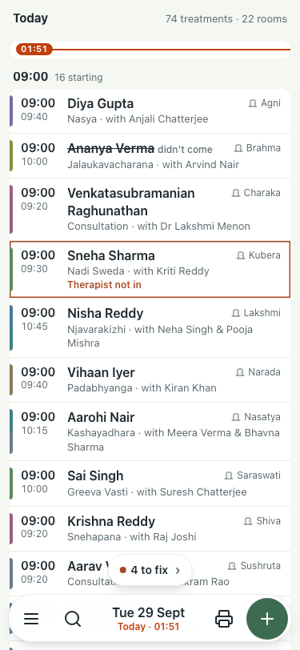
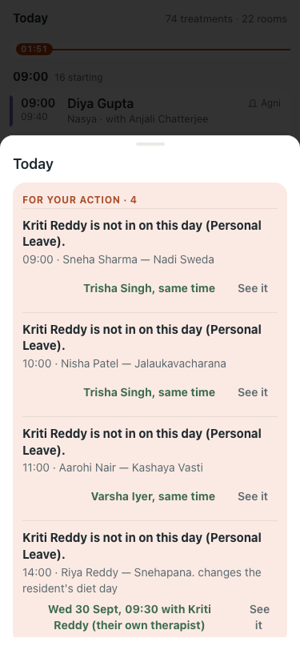
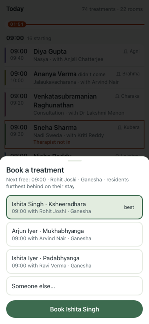

# Ruta

[](https://github.com/jpysh/ayurcalm-scheduler/actions/workflows/ci.yml)
[](LICENSE)
[](https://scorecard.dev/viewer/?uri=github.com/jpysh/ayurcalm-scheduler)
[](https://www.bestpractices.dev/projects/15691)
[](SECURITY.md)

**Your centre's day, printed and ready by 7 am.** Open-source scheduling for Ayurveda centres, therapy studios and wellness retreats.

[Website](https://jains.es/ruta) · [Live demo](https://demo.jains.es) · [Free cloud trial](https://signup.jains.es) · [Self-host guide](docs/self-host.md) · [Admin guide](docs/admin-guide.md)

<a href="https://jains.es/ruta/video.mp4"></a>

Plan residents and their stays, therapists, rooms, therapies and daily programme in one place. Auto-assign fills the day around room amenities, therapist time off and opening hours, and the day sheet prints every resident's treatments and meals for the notice board. Built for residential Ayurveda centres; nothing in it is Ayurveda-specific.

Made for the admin's phone. A desktop only widens it.

<p>



</p>

## Three ways in

1. **Look around:** the [live demo](https://demo.jains.es), a busy example centre. Nothing to install.
2. **Try it on your centre:** a [free cloud trial](https://signup.jains.es). We host it; you get a web address for every phone.
3. **Run it yourself, free:** on a computer that stays on at the centre. Phones reach it over the centre Wi-Fi, or from anywhere with your own web address. [Self-host guide](docs/self-host.md).

## Cloud or self-host?

Same app, same features. The difference is who runs it.

| | Self-host | Ruta Cloud |
|---|---|---|
| Price | Free | Monthly per centre, [see pricing](https://jains.es/ruta) |
| Hosting, HTTPS, backups, updates | You | Us |
| Support by WhatsApp, email or phone | Community | Included |
| Setup help with your therapies, rooms and rota | No | Included |

You can move between them at any time and always leave with your data.

## Quick start

You need [Docker](https://docs.docker.com/get-docker/) on a computer with about 2 GB of free memory. Tested on macOS.

```bash
git clone https://github.com/jpysh/ayurcalm-scheduler.git
cd ayurcalm-scheduler
docker compose up -d
```

Open **http://localhost:8080** (or `http://<computer-name>.local:8080` from a phone on the same Wi-Fi) and sign in as `admin@example.com` / `demo1234`. The first boot seeds an example centre (about 40 residents a day), and a setup wizard asks for your centre's name and hours. Change the password before putting it on a network.

Running it for a real centre (Wi-Fi only, or a web address with HTTPS, plus backups and updates): [docs/self-host.md](docs/self-host.md).

## Stack

React, Vite and TypeScript front end; Express, Prisma and PostgreSQL 16 API; Playwright end-to-end tests. Two containers in total.

## Contributing

Issues, ideas and pull requests welcome: [CONTRIBUTING.md](CONTRIBUTING.md). Security reports: [SECURITY.md](SECURITY.md). Not sure if it's a bug? Ask in [Discussions](https://github.com/jpysh/ayurcalm-scheduler/discussions).

## License

[AGPL-3.0](LICENSE) © jpysh

Free to run for your own centre, to read and to change. If you run a modified copy as a service for others, you must publish your changes under the same licence. To resell or embed it without that, ask for a commercial licence: open a [Discussion](https://github.com/jpysh/ayurcalm-scheduler/discussions) or write via [jains.es/ruta](https://jains.es/ruta).
